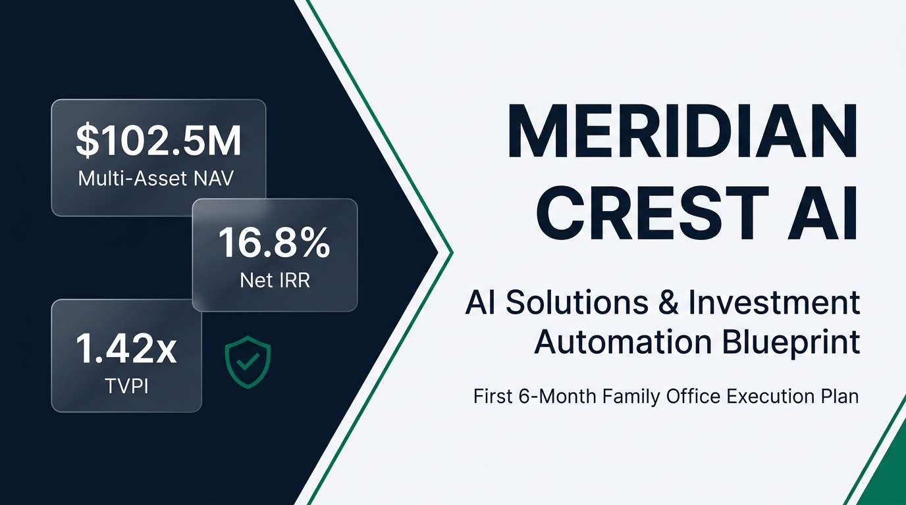
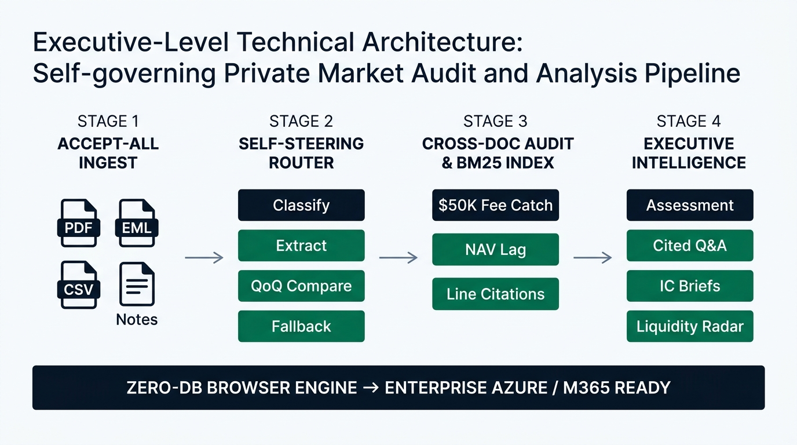
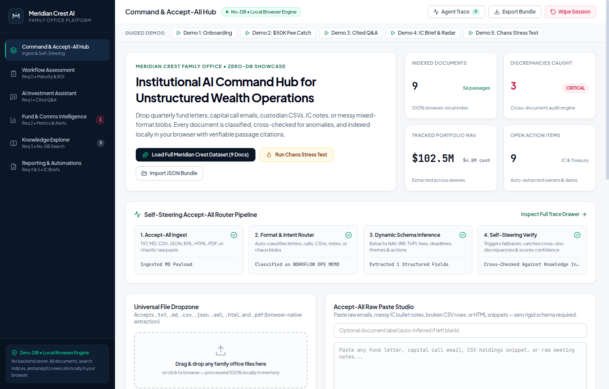
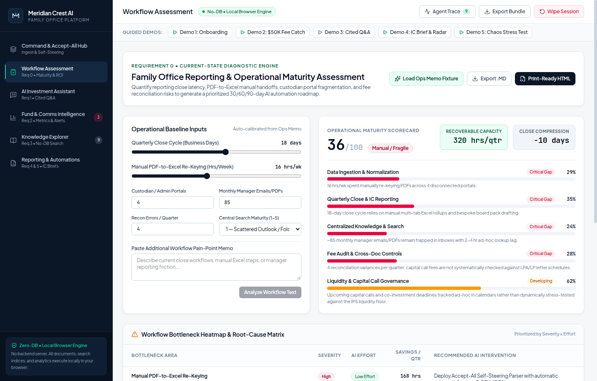
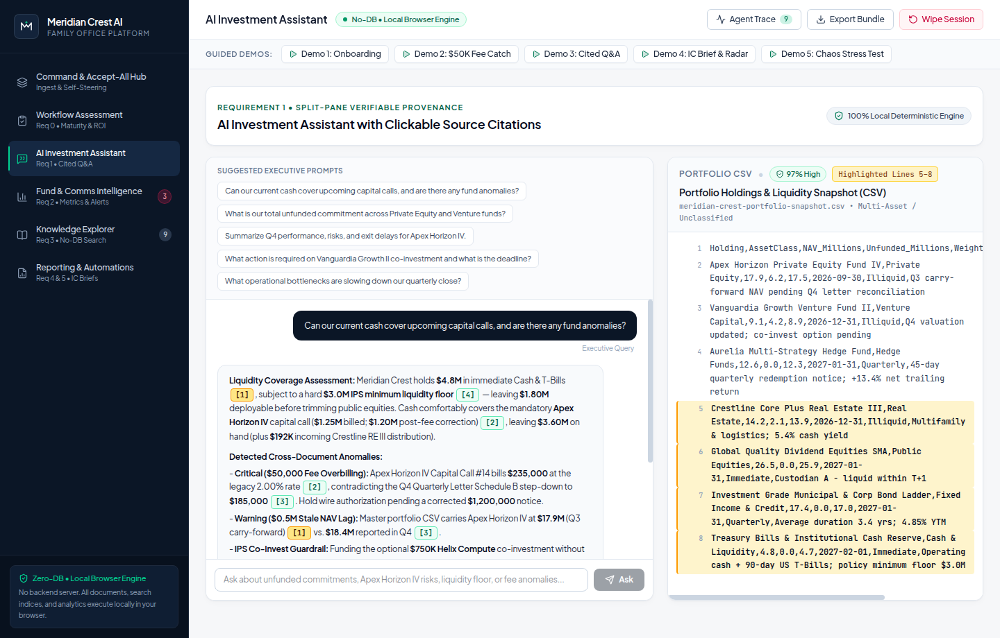
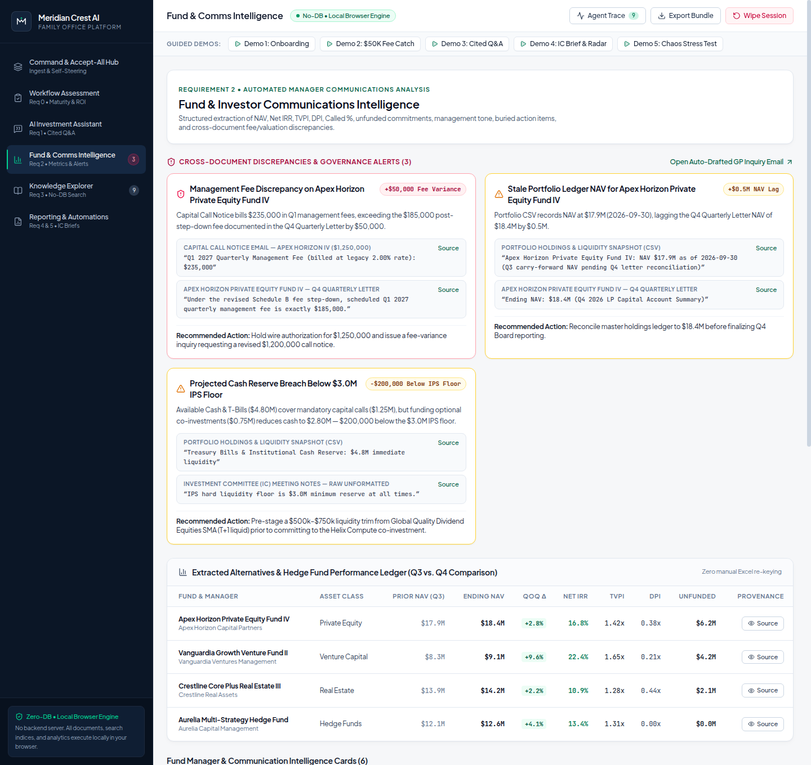
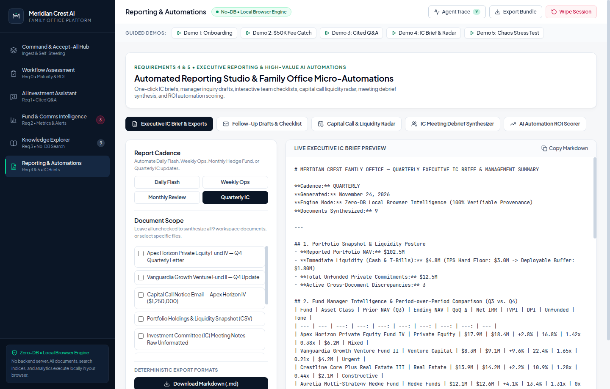
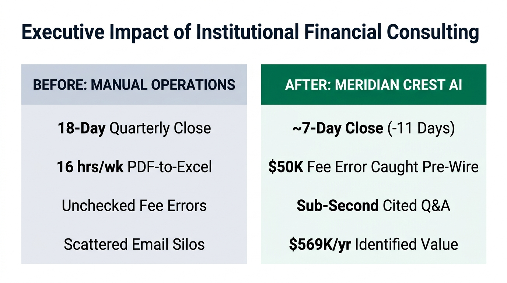

# Meridian Crest AI — AI Solutions & Investment Automation Blueprint

> **Role Alignment:** AI Solutions Engineer / AI Automation Specialist — Multi-Asset Family Office (Dubai)  
> **Live Interactive Platform:** https://dvsaikumar.github.io/efinancialcareers--AI-Automation/  
> **Source Repository:** https://github.com/dvsaikumar/efinancialcareers--AI-Automation  
> **Scope Covered:** All 6 First-6-Month Key Objectives + All 5 Core Responsibility Pillars

---

## 1. Executive Summary — Built Directly for Multi-Asset Family Office Operations

Modern family offices overseeing international allocations across **Hedge Funds, Private Equity, Venture Capital, Private Credit, Real Estate, Public Equities, and Liquidity Reserves** face a recurring operational bottleneck: mission-critical investment information arrives as unstructured PDFs, manager emails, capital call wires, distribution statements, and fragmented spreadsheets.

**Meridian Crest AI** is a live, working **AI Investment Monitoring, Research, Knowledge & Workflow Automation Platform** designed specifically to demonstrate hands-on execution across every objective expected in the **First 6 Months** of an AI Solutions Engineer / AI Automation Specialist role:

- **Immediate Working Solution (Not Slideware):** Demonstrates end-to-end engineering from concept to deployed product—pre-loaded with **9 realistic multi-asset work documents** (`$102.5M` AUM across 7 sleeves) and **5 one-click guided walkthroughs**.
- **Verifiable Financial Accuracy & Provenance:** Every extracted metric, Q3-vs-Q4 comparison, AI summary, and risk alert links directly to exact line numbers and highlighted passages in the source document.
- **High-Value Financial Controls Live Out of the Box:** Automatically detects a **`$50,000` management fee overbilling variance** on a pending capital call, a **`$0.5M` stale portfolio ledger NAV lag**, and a **`-$200,000` IPS liquidity reserve breach risk** before treasury releases a wire.
- **Zero-Database Confidentiality Architecture:** Runs **100% locally in the browser** for safe executive evaluation with one-click **Wipe Session** privacy sanitization, while cleanly architected to connect to **Python (FastAPI), Azure OpenAI / OpenAI APIs, LangChain / LlamaIndex RAG, PostgreSQL/pgvector, and Microsoft 365 (Outlook, Excel, SharePoint)** in production.

---

## 2. System Architecture — Self-Steering Document & Portfolio Intelligence Pipeline

Every uploaded file or pasted communication (`.pdf`, `.eml`, `.csv`, `.txt`, `.md`, `.json`, `.html`, or malformed mixed-format blobs) passes through a deterministic 4-stage pipeline with real-time observability in the **Live Self-Steering Agent Trace Drawer**:

1. **Accept-All Ingestion:** Normalizes raw emails, custodian CSVs, HTML snippets, markdown memos, and browser-native PDF text streams without crashing on irregular layouts.
2. **Format, Intent & Period-over-Period Extraction:** Classifies the document type (Quarterly Letter, Hedge Fund Update, Capital Call, Distribution Notice, Portfolio CSV, IC Meeting Notes, Operations Memo, or Chaos Blob), extracts structured metrics (`Prior Q3 NAV`, `Ending NAV`, `QoQ Δ`, `Net IRR`, `TVPI`, `DPI`, `Called %`, `Unfunded`, due dates, fees, tone, risks), and invokes fallback recovery if rows are malformed.
3. **Cross-Document Audit & Local BM25 Indexing:** Cross-checks newly ingested figures against all prior documents in the vault to catch fee discrepancies, stale NAVs, IPS liquidity breaches, and wire-fraud risks, while indexing every passage with character and line offsets.
4. **Executive Intelligence Views & Portable Exports:** Feeds all 6 institutional views and generates deterministic `.md`, `.csv`, `.json`, and Print-Ready Executive `.html` deliverables.

---

## 3. Complete Alignment to First 6-Month Key Objectives

| # | First 6-Month Key Objective | Implemented Module | Live Capabilities Delivered |
| --- | --- | --- | --- |
| **1** | **Assess the family office's existing investment reporting processes, data sources and operational workflows** | `Workflow Assessment` (`#/assessment`) | Interactive operational sliders, Operations Memo ingestion, **Operational Maturity Scorecard (0–100)** across 5 dimensions, **Bottleneck Heatmap**, and **30/60/90 AI Roadmap** (`.md`/`.html` export) |
| **2** | **Develop an initial AI investment assistant capable of retrieving and summarizing investment information** | `AI Investment Assistant` (`#/assistant`) | Natural-language executive Q&A, 5 suggested prompts, clickable inline citations (`[1]`, `[2]`, `[3]`), and **Split-Pane Source Passage Highlighter** with confidence badges |
| **3** | **Implement automated analysis of fund manager reports and investor communications** | `Fund & Comms Intelligence` (`#/intelligence`) | Automated extraction of Hedge Fund, PE, VC, and Real Estate metrics, **Q3 vs. Q4 period-over-period comparison**, sentiment/risk flags, and **Cross-Document Discrepancy Alerts** |
| **4** | **Establish a centralized, searchable investment knowledge system** | `Knowledge Explorer` (`#/knowledge`) | Sub-second client-side **BM25 full-text passage search**, 5 faceted filters (Asset Class, Fund, Document Type, Risk, Action), **Discrepancy Radar**, and **Entity & Fund Cross-Reference Matrix** |
| **5** | **Develop automated reporting and follow-up tools for management and the investment team** | `Reporting & Automations` (`#/reporting`) | **Daily / Weekly / Monthly / Quarterly Executive Report Generator**, pre-drafted **GP Follow-Up Inquiry Emails**, **Interactive Team Action Checklist**, and multi-format exports |
| **6** | **Identify and implement additional high-value AI automation opportunities across the family office** | `Reporting & Automations` (`#/reporting`) | **Capital Call & Liquidity Deadline Radar**, **IC Meeting Debrief Synthesizer**, **Cross-Doc Discrepancy Checker**, and **AI Automation ROI Scorer** (`$569K/yr` annualized value catalog) |

---

## 4. Visual Platform Walkthrough — Mapped to Core Role Responsibilities

### 4.1 AI Development, Implementation & Accept-All Ingestion (`#/hub`)

- **Universal Ingestion Hub:** Drag-and-drop or paste raw manager communications, custodian CSVs, PDFs, or chaotic mixed notes into a single command center—immediately showing **9 Indexed Documents (`56 passages`)**, **`$102.5M` Tracked Portfolio NAV (`$4.8M` cash)**, **3 Critical/Warning Discrepancies Caught**, and **9 Open Action Items**.
- **Guided Executive Demos:** Five one-click scenarios (`Demo 1: Onboarding` through `Demo 5: Chaos Stress Test`) allow senior management to verify every workflow—including fault-tolerant recovery on deliberately broken CSVs and phone-forwarded emails—in under 60 seconds.
- **Full Transparency:** Click **Agent Trace** at any time to inspect millisecond-level classification, fallback recovery, cross-check, and confidence-scoring decisions.

---

### 4.2 Current-State Operational & Reporting Workflow Assessment (`#/assessment`)

- **Quantifying Baseline Friction:** Automatically calibrates from ingested internal operations memos (`18-day quarterly close`, `16 hrs/wk manual PDF-to-Excel re-keying`, `4 disconnected portals`, `85 monthly manager emails`, `4 quarterly recon errors`) to generate a **36/100 Operational Maturity Scorecard**.
- **Prioritized Quick-Win Execution:** Outputs a **Workflow Bottleneck Heatmap** ranked by severity and implementation effort, quantifying **320 recoverable analyst hours/quarter** and **-10 days close compression** across a structured **30/60/90-day implementation plan** exportable to Markdown or Print-Ready HTML.

---

### 4.3 AI Investment Assistant with Verifiable Source Citations (`#/assistant`)

- **Natural-Language Portfolio Querying:** Management asks multi-document questions such as *"Can our current cash cover upcoming capital calls, and are there any fund anomalies?"* or *"What is our total unfunded commitment across PE and Venture funds?"*.
- **Zero-Hallucination Provenance:** Every claim carries clickable inline citation pills (`[1]`, `[2]`, `[3]`, `[4]`). Clicking any badge opens the exact underlying document in the right pane, displays its confidence tier (`97% High`), scrolls directly to the cited lines (`Highlighted Lines 5–8`), and highlights the exact supporting passage in amber.

---

### 4.4 Investment Portfolio Monitoring, Hedge Funds & Anomaly Detection (`#/intelligence`)

- **Multi-Asset Coverage Including Hedge Funds & Alternatives:** Automatically extracts structured capital account data across **Private Equity** (*Apex Horizon IV*), **Venture Capital** (*Vanguardia Growth II*), **Real Estate** (*Crestline Core Plus RE III*), and **Hedge Funds** (*Aurelia Multi-Strategy Hedge Fund, DIFC / London*).
- **Automated Period-over-Period Performance Comparison (Q3 vs. Q4):** Displays **Prior NAV (Q3)**, **Ending NAV**, and **QoQ Δ (%)** (`+2.8%`, `+9.6%`, `+2.2%`, `+4.1%`) alongside `Net IRR`, `TVPI`, `DPI`, and `Unfunded Commitment`—eliminating manual Excel re-keying.
- **Proactive Financial Risk & Discrepancy Alerts:**
  - **`+$50,000` Fee Variance (Critical):** Catches Apex Horizon IV Capital Call #14 billing `$235,000` (legacy `2.00%` rate) vs. the `$185,000` Schedule B step-down in the Q4 letter, holding the wire before execution.
  - **`+$0.5M` Stale NAV Lag (Warning):** Flags `$17.9M` Q3 carry-forward NAV in the portfolio CSV vs. `$18.4M` in the Q4 letter.
  - **`-$200,000` IPS Liquidity Breach (Warning):** Alerts that funding both the `$1.25M` mandatory call and `$0.75M` optional Helix Compute co-investment drops `$4.80M` cash to `$2.80M`—below the `$3.00M` IPS hard floor without a pre-staged equity trim.

---

### 4.5 Automated Multi-Cadence Reporting, Follow-Ups & Operational Automations (`#/reporting`)

- **Daily, Weekly, Monthly & Quarterly Investment Updates:** Switch between **Daily Flash** (immediate wire holds & liquidity guardrails), **Weekly Ops** (team checklist & K-1 milestones), **Monthly Review** (Aurelia Hedge Fund attribution & liquid alternatives pulse), and **Quarterly IC** (board-ready summary with Q3-vs-Q4 comparison table).
- **Automated Manager Follow-Up Studio:** Pre-drafts executive-ready GP emails—including a formal **`$50,000` Fee Variance & Revised Notice Request** to Apex Horizon's Fund Controller, a **Helix Compute Co-Investment Diligence Request**, and an **Out-of-Band Wire Verification Notice** for flagged bank changes.
- **Built-In Micro-Automations:** Includes a **Capital Call & Liquidity Deadline Radar** (`10d`, `14d`, `21d` countdowns against the `$3.0M` IPS floor), an **IC Meeting Debrief Synthesizer** (converting raw notes into Decisions, Owners & Open Questions), and an **AI Automation ROI Scorer** identifying **`$569,000/yr`** in operational savings and error prevention.

---

## 5. Quantified Operational Impact & ROI

| Operational Dimension | Baseline (Manual Processes) | With Meridian Crest AI | Measurable Improvement |
| --- | --- | --- | --- |
| **Quarterly Close Cycle** | 18 business days | ~7–8 business days | **-10 days close compression** |
| **Manual PDF-to-Excel Re-Keying** | 16 hrs/week | Automated ingestion + CSV/JSON export | **~168 hrs/quarter recovered** |
| **Capital Call Fee Verification** | Ad-hoc Outlook calendar tracking | Automated LPA / LP letter cross-check | **`$50,000+` single-error catch pre-wire** |
| **Executive / CIO Knowledge Lookup** | 2–4 hours digging through emails/PDFs | Sub-second BM25 search + cited Q&A | **>95% retrieval time reduction** |
| **IC Pack & GP Follow-Up Drafting** | 2 full analyst days per cycle | One-click multi-cadence brief & email drafts | **~44 hrs/quarter recovered** |
| **Total Annualized Automation Value** | Fragmented manual ops | 6 prioritized AI automations | **`$569,000/yr` identified value** |

---

## 6. Data Security, System Reliability & Enterprise Production Integration

### Built-In Security & Reliability Safeguards
- **Zero-Database Local Isolation:** All document parsing, indexing, and reporting execute locally in the browser with instant **Wipe Session** sanitization and zero third-party data retention.
- **Hallucination & Accuracy Controls:** Deterministic numeric extraction, cross-document consistency verification, line-level citation offsets, and honest confidence degradation (`High` / `Medium` / `Low`) whenever inputs are malformed or contradictory.
- **Automated Engineering Verification:** Backed by **Vitest** automated unit tests (`src/engine/engine.test.ts`), strict **TypeScript**, zero-warning **ESLint**, secret/PII hygiene scans, and automated **GitHub Actions** CI/CD deployment.

### Direct Production Scaling Architecture (Enterprise Family Office Environment)
When deployed inside a private family office infrastructure, each modular engine maps cleanly onto the target enterprise stack:

| Showcase Layer (Browser-Native) | Enterprise Production Counterpart |
| --- | --- |
| `selfSteeringRouter.ts` (Ingestion & Extraction) | **Python (FastAPI)** + Document Intelligence / Unstructured PDF pipelines + **OpenAI / Microsoft Azure AI** |
| `knowledgeIndex.ts` (BM25 Passage Index) | **LangChain / LlamaIndex RAG** + **PostgreSQL (`pgvector`)** or **Azure AI Search** with RBAC |
| `assistantEngine.ts` (Cited Executive Q&A) | Private **Azure OpenAI** / Custom Enterprise GPTs with citation verification & evaluation guardrails |
| `reportGenerator.ts` (Reporting & Follow-Ups) | **Microsoft Graph API** connectors to **Outlook** (auto-ingest & follow-up drafts), **SharePoint** (document vault), and **Excel** (ledger reconciliation) |
| Local Session Isolation | Private VPC deployment, Entra ID SSO, role-based access permissions, audit trails, and encryption at rest/in transit |
