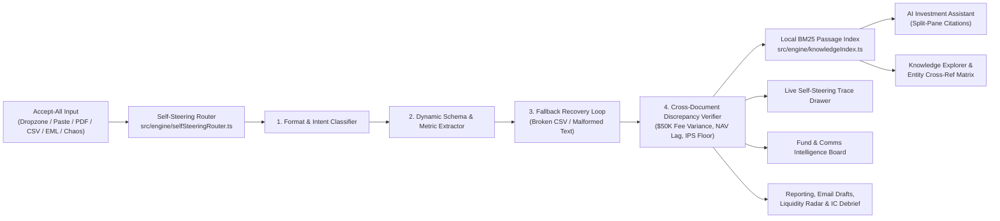

# Architecture — Meridian Crest AI (Zero-Database Family Office Platform)

## 1. Architectural Mandate & Design Decisions

Meridian Crest AI is engineered as a **100% browser-native, zero-database institutional showcase** deployed as a static bundle on GitHub Pages. No SQL database, NoSQL store, backend API server, or third-party proxy is required.

### Core Pragmatic Decisions
1. **Static Client-Side Runtime (`Vite + React 19 + TypeScript + Tailwind CSS v4`):**
   - Configured with `base: './'` in `vite.config.ts` so all JS/CSS/SVG assets resolve cleanly under both root domains and GitHub Pages subpaths (`https://<user>.github.io/<repo>/`).
   - Uses hash-based routing (`#/hub`, `#/assessment`, `#/assistant`, `#/intelligence`, `#/knowledge`, `#/reporting`) paired with `public/404.html` redirect fallback so direct deep links and refreshes never 404.
2. **Data Sovereignty & Zero-DB Persistence:**
   - Workspace documents, parsed metrics, anomalies, and trace runs reside in React memory and optionally sync to browser `localStorage` (`meridian_crest_workspace_v1`).
   - One-click **Wipe Session** clears React state, `localStorage`, and any ephemeral BYOK key immediately.
   - Portable **JSON Workspace Bundles**, **Markdown**, **CSV**, and **Print-Ready Executive HTML** provide full off-platform exportability without a database.
3. **Offline-First Determinism + Optional Ephemeral BYOK:**
   - Every feature (classification, extraction, discrepancy auditing, BM25 search, citation passage offsets, executive Q&A, and report drafting) executes deterministically in the browser so live demos never fail on rate limits or missing credentials.
   - Optional **Ephemeral BYOK Mode** accepts an OpenAI-compatible endpoint/key stored strictly in a React `useRef` (never written to `localStorage` or bundled code), falling back silently to the deterministic local engine if unreachable.

---

## 2. System Dataflow

---

## 3. Module Breakdown

| Module | Path | Responsibility |
| --- | --- | --- |
| Domain Models | `src/types/domain.ts` | Strict TypeScript contracts for documents, metrics, anomalies, trace events, citations, assessments, and exports |
| Synthetic Fixtures | `src/fixtures/meridianCrestData.ts` | 6 synthetic Meridian Crest Family Office documents + Chaos Stress Test payload |
| Self-Steering Router | `src/engine/selfSteeringRouter.ts` | Accept-All ingestion (including lightweight PDF text-stream extraction), classification, metric extraction, fallback recovery, cross-doc verification, confidence scoring, and trace generation |
| Knowledge Index | `src/engine/knowledgeIndex.ts` | Client-side BM25/TF-IDF passage search with character/line offsets, faceted filter summaries, and Entity Cross-Reference Matrix |
| Assessment Engine | `src/engine/assessmentEngine.ts` | Req 0 Operational Maturity Scorecard (5 dimensions), Bottleneck Heatmap, and 30/60/90-day Quick-Win AI Roadmap |
| Assistant Engine | `src/engine/assistantEngine.ts` | Req 1 multi-document Q&A with clickable `[1]`, `[2]` citations and optional ephemeral BYOK synthesis |
| Report & Automation Engine | `src/engine/reportGenerator.ts` | Req 4 & 5 Executive IC Brief builder, GP Follow-Up Email Drafts, IC Debrief Synthesizer, Capital Call Liquidity Radar, ROI Automation Scorer, and `.md`/`.csv`/`.html` exporters |
| Workspace Store | `src/store/WorkspaceContext.tsx` & `workspaceHelpers.ts` | In-memory + `localStorage` state, hash routing, 5 Guided Demo scenarios, session wipe, and JSON import/export |

---

## 4. Verification & Hygiene Standards

- **Automated Unit Tests (`src/engine/engine.test.ts`):** Verifies ingestion of all 6 synthetic fixtures, chaos input recovery without crashing, `$50,000` management fee anomaly detection, `$0.5M` CSV-vs-Q4-letter NAV lag detection, IPS liquidity floor breach alerts, citation offset retrieval, assessment scoring, and multi-format report exports.
- **Public-Repo Secret & PII Hygiene:** 100% synthetic entities (`Meridian Crest Family Office`, `Apex Horizon Private Equity Fund IV`, `Vanguardia Growth Venture Fund II`, `.example` email domains, `000000000` demo routing number). Zero API keys or tokens anywhere in the codebase.
