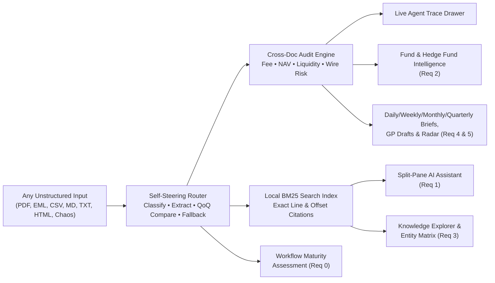

# Meridian Crest AI — Complete Feature & Capabilities Showcase

> **Executive Client Dossier & Technical Portfolio Guide**  
> **Live Interactive Platform:** https://dvsaikumar.github.io/efinancialcareers--AI-Automation/  
> **Source Repository:** https://github.com/dvsaikumar/efinancialcareers--AI-Automation  
> **Architecture:** 100% Browser-Native • Zero-Database • Self-Steering AI Pipeline • GitHub Pages Static Deployment

---

## 1. Executive Summary

**Meridian Crest AI** is an institutional-grade **Family Office AI Intelligence & Automation Platform** engineered specifically for the privacy, auditability, and multi-asset reporting realities of a modern Single-Family or Multi-Family Office managing international portfolios across **Hedge Funds, Private Equity, Venture Capital, Private Credit, Real Estate, Public Equities, and Cash/T-Bills**.

Unlike brittle chatbots or cloud-hosted SaaS tools that force confidential wealth records into external databases, Meridian Crest AI runs **100% client-side inside the browser**:

- **Zero External Database & Zero Backend Server:** No SQL/NoSQL store, no third-party data retention, and zero external API dependency required to run every single workflow reliably.
- **Accept-All Self-Steering Engine:** Ingests messy real-world inputs—quarterly LP letters, monthly hedge fund tearsheets, capital call emails, distribution notices, custodian CSVs, raw IC notes, PDFs, HTML, JSON, or broken multi-format blobs—automatically classifying, extracting, cross-checking, and scoring confidence without crashing.
- **Verifiable Provenance Everywhere:** Every KPI, period-over-period delta, AI answer, and anomaly alert links back to the exact line numbers and highlighted passage in the original source document.
- **Immediate Business Value:** Pre-loaded with **9 synthetic Meridian Crest Family Office work documents** (`$102.5M` AUM across 7 asset sleeves), the platform automatically detects a **`$50,000` GP management fee overbilling error**, a **`$0.5M` stale portfolio ledger NAV lag**, and an **IPS `$3.0M` liquidity floor breach risk** before any treasury wire is released.

---

## 2. Complete Requirement-to-Feature Traceability Matrix

| Client Requirement | Platform View / Module | Core Deliverables Built & Live | Business Outcome |
| --- | --- | --- | --- |
| **Req 0: Current-State Family Office Assessment** | `Workflow Assessment` (`#/assessment`) | Interactive diagnostic controls, free-text memo parser, **Operational Maturity Scorecard (0–100)**, **Bottleneck Heatmap**, **30/60/90 AI Roadmap**, `.md` & Print-Ready `.html` export | Quantifies close latency (`18 days` -> `~7 days`) and recoverable analyst hours (`~320 hrs/qtr`) |
| **Req 1: AI Investment Assistant with Citations** | `AI Investment Assistant` (`#/assistant`) | Conversational Q&A, 5 executive prompt chips, clickable `[1]`/`[2]` inline citations, **Split-Pane Source Passage Highlighter**, confidence badges | Instant, zero-hallucination executive answers with one-click audit trail |
| **Req 2: Fund Manager & Comms Intelligence** | `Fund & Comms Intelligence` (`#/intelligence`) | Structured extraction (`Prior Q3 NAV`, `Ending NAV`, `QoQ Δ`, `Net IRR`, `TVPI`, `DPI`, `Unfunded`), Hedge Fund attribution, tone/sentiment, buried risks, **Cross-Document Anomaly Banners** | Eliminates manual PDF-to-Excel re-keying and catches `$50,000+` fee errors pre-wire |
| **Req 3: Centralized No-DB Knowledge System** | `Knowledge Explorer` (`#/knowledge`) | Client-side BM25 full-text passage search, 5 faceted filters (including Hedge Funds), **Entity & Fund Cross-Reference Matrix**, **Discrepancy & Alert Radar** | Turns scattered Outlook/PDF silos into a sub-second searchable vault with zero database |
| **Req 4: Automated Reporting & Follow-Up Tools** | `Reporting & Automations` (`#/reporting`) | **Multi-Cadence Executive Report Generator** (`Daily Flash`, `Weekly Ops`, `Monthly Review`, `Quarterly IC`), **GP Follow-Up Email Draft Studio**, **Interactive Team Checklist**, `.md`/`.csv`/`.json`/`.html` exports | Compresses daily/weekly/monthly/quarterly reporting & manager follow-ups from days to seconds |
| **Req 5: High-Value AI Automations Hub** | `Reporting & Automations` (`#/reporting`) | **Capital Call & Liquidity Deadline Radar**, **IC Meeting Debrief Synthesizer**, **Cross-Doc Discrepancy Checker**, **AI Automation ROI Scorer** | Identifies `$569,000/yr` in annualized operational savings & error prevention |

---

## 3. Feature-by-Feature Deep Dive

### 3.1 Platform Shell, Privacy Controls & Guided Demo Bar
- **Institutional Wealth Management Aesthetic:** High-contrast porcelain canvas (`#F6F7F9`), crisp hairline borders, deep institutional navy navigation rail (`#0B1626`), sovereign emerald verification accents, **Plus Jakarta Sans** executive typography, and **JetBrains Mono** (`tabular-nums`) for aligned financial figures.
- **One-Click Guided Demo Launcher Bar:** Always pinned beneath the header so stakeholders can jump directly into 5 curated executive scenarios (`Demo 1: Onboarding`, `Demo 2: $50K Fee Catch`, `Demo 3: Cited Q&A`, `Demo 4: IC Brief & Radar`, `Demo 5: Chaos Stress Test`).
- **Pre-Loaded Live Demo Work Data:** First-time visitors immediately land in an active, populated workspace containing **9 synthetic Meridian Crest work documents** (`$102.5M` AUM), active + completed checklist items, live discrepancies, trace logs, and a pre-seeded cited executive Q&A.
- **One-Click Wipe Session:** Instantly purges React state and browser `localStorage`, storing a clean wiped state so privacy is provable on the spot.
- **Portable Workspace Export & Import (`.json`):** Full workspace state can be exported as a versioned `WorkspaceBundle` JSON file and re-imported later—providing persistence portability without any database.

---

### 3.2 View 1 — Command & Accept-All Hub (`#/hub`)
1. **Executive KPI Strip:** Real-time cards summarizing **Indexed Documents & Passages**, **Discrepancies Caught** (with `CRITICAL` alert badge), **Tracked Portfolio NAV & Cash**, and **Open Action Items**.
2. **Self-Steering Router Pipeline Visualizer:** Live 4-stage visual telemetry (`1. Accept-All Ingest` → `2. Format & Intent Router` → `3. Dynamic Schema Inference` → `4. Self-Steering Verify`) displaying status icons (`ok`, `warn`, `alert`) and latest extracted decision labels.
3. **Universal File Dropzone:** Drag-and-drop or browse support for `.txt`, `.md`, `.csv`, `.json`, `.eml`, `.html`, and `.pdf` (including a lightweight browser-native PDF text-stream extractor with printable-string fallback for compressed/scanned files).
4. **Accept-All Raw Paste Studio:** Paste unformatted emails, broken CSV rows, meeting notes, or HTML snippets with optional labels—no schema template required.
5. **Individual Synthetic Fixture Toggles & Chaos Stress Test Trigger:** One-click buttons to load all 8 Meridian Crest documents individually or launch the malformed mixed-format **Chaos Stress Test**.
6. **Local Workspace Document Vault:** Lists every ingested document with auto-detected document type badge, quantitative confidence score (`High` / `Medium` / `Low`), `Fallback Recovered` indicator, parse warnings, one-click **Source Inspector**, and individual delete controls.

---

### 3.3 View 2 — Workflow Assessment Studio (`#/assessment` — Req 0)
1. **Interactive Operational Baseline Sliders & Controls:** Real-time adjustable inputs for **Quarterly Close Cycle (business days)**, **Manual PDF-to-Excel Re-Keying (hrs/wk)**, **Custodian/Admin Portals**, **Monthly Manager Emails/PDFs**, **Reconciliation Errors/Quarter**, and **Central Search Maturity (1–5)**—automatically calibrated when an Operations Memo is ingested.
2. **Free-Text Workflow Memo Analyzer:** Paste any family office operations description to dynamically recalibrate maturity scores and bottleneck evidence.
3. **Operational Maturity Scorecard:** Computes an overall **0–100 Maturity Score**, **Maturity Band** (`Manual / Fragile`, `Transitional`, `AI-Assisted`, `Institutional AI-Native`), **Recoverable Capacity (`hrs/qtr`)**, **Close Compression (`-days`)**, and 5 visual dimension progress bars:
   - *Data Ingestion & Normalization*
   - *Quarterly Close & IC Reporting*
   - *Centralized Knowledge & Search*
   - *Fee Audit & Cross-Doc Controls*
   - *Liquidity & Capital Call Governance*
4. **Bottleneck Heatmap & Root-Cause Matrix:** Prioritized table mapping each bottleneck area by **Severity**, **AI Implementation Effort**, **Quarterly Hours Saved**, **Root Cause**, and **Recommended AI Intervention**.
5. **30 / 60 / 90-Day Quick-Win AI Automation Roadmap:** Three phased execution cards (*Days 1–30 Quick Wins*, *Days 31–60 Core Automation*, *Days 61–90 Executive Intelligence*) with concrete deliverables and quarterly hour savings.
6. **One-Click Executive Exports:** Download the full assessment as **Markdown (`.md`)** or **Print-Ready Executive HTML (`.html`)**.

---

### 3.4 View 3 — AI Investment Assistant with Split-Pane Citations (`#/assistant` — Req 1)
1. **Suggested Executive Prompt Chips:** Pre-loaded high-impact executive questions (e.g., *"Can our current cash cover upcoming capital calls, and are there any fund anomalies?"*, *"What is our total unfunded commitment across Private Equity and Venture funds?"*, *"Summarize Q4 performance, risks, and exit delays for Apex Horizon IV."*).
2. **Multi-Document Grounded Reasoning:** Synthesizes answers across portfolio CSVs, LP letters, capital calls, IC notes, and operations memos—performing live liquidity math, unfunded commitment rollups, anomaly callouts, and risk summaries.
3. **Clickable Inline Citations (`[1]`, `[2]`, `[3]`, `[4]`):** Every factual claim includes interactive numbered citation pills plus verified citation source chips beneath each response.
4. **Live Split-Pane `SourcePassageViewer`:** Clicking any citation pill immediately opens the exact source document in the right pane, displays its document type and confidence badge, smoothly scrolls to the exact line range (`Lines X–Y`), and highlights the exact cited passage in amber.

---

### 3.5 View 4 — Fund & Investor Communications Intelligence (`#/intelligence` — Req 2)
1. **Cross-Document Discrepancy & Governance Alert Banners:** Automatically cross-checks every newly ingested document against the entire vault to surface:
   - **Critical (`+$50,000` Fee Variance):** Catches Apex Horizon IV Capital Call #14 billing `$235,000` (legacy `2.00%` rate) vs. the `$185,000` Schedule B step-down documented in the Q4 Quarterly Letter, recommending a wire hold and corrected `$1,200,000` notice.
   - **Warning (`+$0.5M` NAV Lag):** Catches the master Portfolio CSV carrying Apex Horizon IV at `$17.9M` (Q3 carry-forward) vs. `$18.4M` in the Q4 Letter.
   - **Warning (`-$200,000` IPS Floor Breach Risk):** Flags that funding both the Apex Horizon IV call and optional `$750,000` Helix Compute co-investment drops `$4.8M` cash below the `$3.0M` IPS hard floor without a pre-staged equity SMA trim.
   - **Chaos Recovery Flags (Demo 5):** Catches internal IRR self-contradictions (`11.4%` vs. `13.8%`) and unverified bank-change phishing/wire-fraud warnings.
   - Each alert displays quoted side-by-side evidence snippets with one-click **Source** provenance links.
2. **Extracted Alternatives & Hedge Fund Performance Ledger (Q3 vs. Q4 Period-over-Period Comparison):** Structured institutional table consolidating **Fund & Manager**, **Asset Class**, **Prior NAV (Q3)**, **Ending NAV**, **QoQ Δ (%)**, **Net IRR**, **TVPI**, **DPI**, **Unfunded Commitment**, and **Provenance** across Apex Horizon IV, Vanguardia Growth II, Aurelia Multi-Strategy Hedge Fund, and Crestline Core Plus Real Estate III.
3. **Structured Intelligence Cards:** Per-document executive breakdown displaying **Document Type**, **Management Tone/Sentiment** (`Constructive`, `Mixed`, `Urgent`, `Cautious`), **Confidence %**, extracted financial chips (Call amount, Billed vs. Scheduled Fee, Co-Invest amount, Due countdown), **Key Themes**, and **Risks & Buried Flags**.

---

### 3.6 View 5 — Centralized No-DB Knowledge Explorer (`#/knowledge` — Req 3)
1. **Instant Client-Side BM25/TF-IDF Passage Search:** Tokenizes, removes stop words, applies fuzzy prefix/stem matching, and scores passage relevance with exact phrase bonuses in milliseconds—entirely in browser memory.
2. **Multi-Facet Filter Bar:** Filter live results across **Asset Class** (including Hedge Funds, Private Equity, Venture Capital, Real Estate, Fixed Income & Credit), **Fund & Vehicle**, **Document Type**, **Risk Flagged**, and **Action Required**.
3. **Matched Knowledge Passages:** Displays exact matched excerpts with line numbers, asset class badges, highlighted matched terms, and one-click **Open** source inspection.
4. **Discrepancy & Alert Radar:** Dedicated side panel listing all active cross-document conflicts and governance warnings.
5. **Auto-Generated Entity & Fund Cross-Reference Matrix:** Automatically maps tracked Funds (including *Aurelia Multi-Strategy Hedge Fund*), Portfolio Companies (*Helix Compute*, *Northstar Logistics*, *Solara MedTech*), and Risk/Governance themes (*Management Fee Step-Down*, *IPS `$3.0M` Liquidity Floor*, *Manual PDF-to-Excel Close Latency*) to mention counts and clickable source document links.

---

### 3.7 View 6 — Automated Reporting & High-Value AI Automations (`#/reporting` — Req 4 & 5)
Organized into **5 interactive executive sub-studios**:

1. **Multi-Cadence Executive Reports & Multi-Format Exports (`Daily Flash` | `Weekly Ops` | `Monthly Review` | `Quarterly IC`):**
   - Switch instantly between **Daily Treasury & Risk Flash**, **Weekly Operations & Follow-Up Brief**, **Monthly Multi-Asset & Hedge Fund Review**, and **Quarterly Executive IC Brief** (including automated **Q3 vs. Q4 Period-over-Period** comparison tables).
   - Select specific documents or synthesize the entire vault, then **Copy Markdown** or export `.md`, `.csv`, `.json`, or **Print-Ready Executive HTML (`.html`)**.
2. **Follow-Up Draft Studio & Interactive Team Action Checklist:**
   - Auto-generates ready-to-send emails tailored to live workspace findings:
     - *Apex Horizon IV — `$50,000` Fee Variance & Revised Notice Request* (Critical)
     - *Vanguardia Growth II — Helix Compute Co-Invest Election & Diligence Request* (High)
     - *Bridge Credit III — Out-of-Band Wire Instruction & IRR Verification* (triggered when Chaos Stress Test is run)
   - One-click **Copy Draft** (`To`, `Subject`, and formatted executive body).
   - **Interactive Team Action Checklist:** Auto-populated from documents + pre-seeded completed reconciliation tasks + inline form to add custom tasks with owner & priority, toggle completion state, and reflect completion directly in exported briefs.
3. **Capital Call & Liquidity Deadline Radar:**
   - 4 live liquidity KPI cards: **Immediate Cash & T-Bills (`$4.80M`)**, **IPS Minimum Reserve Floor (`$3.00M`)**, **Post-Mandatory Calls Cash (`$3.55M`)**, and **Post-Optional Co-Invest Cash (`$2.80M` — breach alert)**.
   - Visual **30-Day Stacked Cash Allocation Bar** contrasting Mandatory Calls, Optional/Pending commitments, and Remaining Reserve.
   - Chronological **Deadline Countdown Timeline** (`10d`, `14d`, `21d`) with status badges (`Flagged Discrepancy`, `Decision Needed`) and notes.
4. **IC Meeting Prep & Debrief Synthesizer:**
   - Automatically ingests raw IC meeting notes (or lets the user paste new messy notes live) and structures them into **Decisions & Provisional Approvals**, **Assigned Owners & Due Dates**, **Open Diligence Questions**, and **Risk Highlights**.
5. **Family Office AI Automation Opportunity & ROI Scorer:**
   - Ranks 6 high-value family office automations (4 `Live in Workspace`, 2 `Ready to Deploy`) by **Hours Saved / Quarter**, **Implementation Effort**, **Annualized Value (`$569,000/yr` total identified)**, and **ROI Score (out of 100)**.

---

### 3.8 Live Self-Steering Agent Trace Drawer
Accessible globally from the top bar (`Agent Trace`), this dark-navy collapsible audit drawer records every ingestion run with:
- Chronological pipeline stages (`INGEST`, `CLASSIFY`, `EXTRACT`, `FALLBACK`, `INDEX`, `CROSS_CHECK`, `CONFIDENCE`)
- Per-step execution latency in milliseconds
- Status indicators (green check, amber fallback warning, crimson discrepancy alert)
- Explainable confidence score calculation (e.g., `97% High` for structured LP letters vs. `36% Low` for broken mixed-format chaos drops)

---

## 4. Bundled Synthetic Workspace Data ("Meridian Crest Family Office")

All data is **100% synthetic** (verified clean by automated secret & PII scan):

| # | Document | Type | Key Synthetic Data & Built-In Insights |
| --- | --- | --- | --- |
| 1 | `apex-horizon-iv-q4-letter.txt` | Quarterly Letter | `$18.4M` NAV (`+2.8%` vs `$17.9M` Q3), `16.8%` Net IRR, `1.42x` TVPI, `0.38x` DPI, `$6.2M` unfunded, Northstar exit delay, Schedule B **`$185,000`** Q1 fee step-down |
| 2 | `vanguardia-growth-ii-q4-update.md` | Quarterly Letter | `$9.1M` NAV (`+9.6%` vs `$8.3M` Q3), `22.4%` Net IRR, `1.65x` TVPI, `$4.2M` unfunded, Helix Compute **`$750,000`** co-invest due in **14 days** |
| 3 | `aurelia-multistrat-hedge-fund-letter.txt` | Hedge Fund Letter | DIFC/London Multi-Strategy Hedge Fund: `$12.6M` NAV (`+4.1%` vs `$12.1M` Q3), `13.4%` Net IRR, `1.85` Sharpe, 45-day quarterly redemption terms, sovereign curve crowding watch |
| 4 | `apex-horizon-iv-capital-call.eml` | Capital Call | **`$1,250,000`** wire due in **10 days**; bills **`$235,000`** fee -> triggers **`$50,000` fee overbilling alert** |
| 5 | `meridian-crest-portfolio-snapshot.csv` | Portfolio CSV | 7 sleeves (`$102.5M` total NAV across Hedge Funds, PE, VC, RE, Public Equities, Credit, Cash), **`$4.8M`** Cash/T-Bills, carries Apex at `$17.9M` -> triggers **`$0.5M` NAV lag alert** |
| 6 | `ic-meeting-notes-feb-2027.txt` | IC Meeting Notes | Raw unformatted notes establishing **`$3.0M` IPS hard liquidity floor**, `$500K` SMA rebalance plan, and follow-up owners |
| 7 | `current-state-operations-memo.txt` | Ops Memo | Documents **18-day close**, **16 hrs/wk** PDF-to-Excel re-keying, **4 portals**, **85 monthly emails**, and zero centralized search |
| 8 | `crestline-re-iii-q4-distribution.txt` | Distribution Notice | `$14.2M` NAV (`+2.2%` vs `$13.9M` Q3), `10.9%` Net IRR, `1.28x` TVPI, **`$192,000`** quarterly distribution (`5.4%` yield), zero Q1 capital calls |
| 9 | `q1-2027-k1-tax-audit-schedule.md` | Tax & Audit Work Schedule | Partnership K-1 delivery dates, Whitmore & Hale LLP CPA deadlines, and operations queue |
| + | `chaos-mixed-dump-2027.txt` | Chaos Stress Test (Demo 5) | Malformed CSV + phone-forwarded email fragment + conflicting IRR (`11.4%` vs `13.8%`) + wire-fraud phishing warning |

---

## 5. Production Enterprise Scaling Path (For Dubai Family Office Deployment)

This live GitHub Pages showcase runs **100% browser-native with zero database** so stakeholders can safely evaluate every 6-month deliverable immediately with zero setup or data exposure. In a private production family office deployment, the exact same modular architecture connects directly to:

- **Backend & AI Orchestration:** Python (`FastAPI`), Azure OpenAI / OpenAI Enterprise APIs, LangChain / LlamaIndex RAG pipelines, and automated evaluation harnesses.
- **Enterprise Data & Vector Layer:** PostgreSQL + `pgvector` (or Azure AI Search) with strict RBAC, audit logging, and private VPC isolation.
- **Microsoft 365 Native Integrations:** Microsoft Graph API connectors for automated **Outlook** email/attachment ingestion, **SharePoint** document vault sync, and **Excel** portfolio ledger reconciliation.

---

## 6. Technical, Architectural & Product Skills Demonstrated

This platform serves as a live, inspectable demonstration of end-to-end **Principal-Level AI & Full-Stack Engineering** capabilities:

| Skill Domain | Concrete Proof in This Repository |
| --- | --- |
| **AI Systems Architecture** | Designed a **Zero-Database, Self-Steering Agentic Pipeline** (`Classify → Extract → QoQ Compare → Fallback Recover → Cross-Check → Confidence Score → Trace`) running deterministically offline in the browser. |
| **Domain Fluency (Private Wealth & Family Offices)** | Accurate modeling of **Hedge Funds, Private Equity, Venture Capital, Private Credit, Real Estate**, LP capital accounts (`NAV`, `QoQ Δ`, `Net IRR`, `TVPI`, `DPI`, `Unfunded`), LPA management fee step-downs, IPS liquidity reserve floors, co-investment pacing, K-1 tax schedules, and dual-control wire fraud risk. |
| **Search & Information Retrieval (IR)** | Implemented a custom client-side **BM25/TF-IDF passage search engine** with fuzzy stem matching, character/line citation offset tracking, faceted aggregation, and an automatic Entity Cross-Reference Matrix—zero external vector DB required. |
| **Frontend Engineering & Executive UX** | Built a crisp, institutional **React 19 + TypeScript (strict mode) + Tailwind CSS v4** application with responsive split-pane citation highlighting, collapsible trace telemetry, multi-cadence reporting, accessible print styles, and a lean **~490 KB** total production bundle. |
| **Resilience & Chaos Engineering** | Engineered fault-tolerant parsing for broken CSVs, unclosed quotes, malformed JSON, HTML stripping, and lightweight browser-native PDF stream extraction—verified by an interactive Chaos Stress Test with honest confidence downgrading. |
| **Quality Assurance & Automated Testing** | Built a fast **Vitest** automated test suite (`src/engine/engine.test.ts`) verifying all 9 synthetic docs, Hedge Fund extraction, Q3-vs-Q4 deltas, chaos recovery, `$50,000` fee anomaly catch, NAV lag catch, citation offsets, assessment scoring, and all 4 report cadences—paired with strict `tsc --noEmit` and zero-warning ESLint enforcement. |
| **Security, Privacy & Public-Repo Hygiene** | Enforced strict zero-secret hygiene (automated secret/PII scans), 100% synthetic data, zero external persistence, and instant local session wipe controls. |
| **Autonomous DevOps & CI/CD** | Authored a clean GitHub Actions pipeline (`.github/workflows/deploy-pages.yml`) executing `npm ci`, automated unit tests, TypeScript & ESLint checks, Vite production build, and HTTPS-enforced GitHub Pages deployment with SPA `404.html` + hash routing. |
