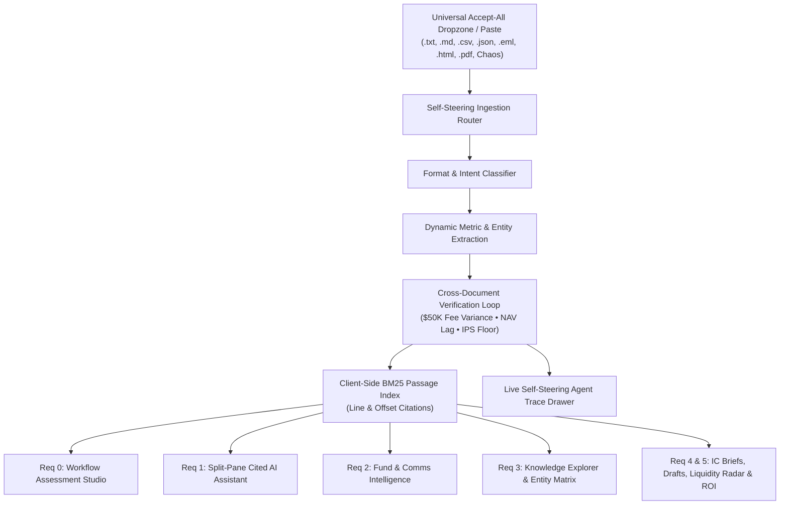

# Meridian Crest AI — Family Office Intelligence Platform

An institutional, **zero-database**, browser-native AI workspace engineered for Family Office investment operations. Built with **Vite, React, TypeScript, and Tailwind CSS** for instant static deployment on **GitHub Pages**.

> **Privacy & Data Sovereignty First:** Runs 100% locally in your browser with zero backend servers, zero external databases, zero committed secrets, and one-click **Wipe Session** privacy controls. All bundled data is 100% synthetic ("Meridian Crest Family Office").

---

## Architecture Overview



---

## Coverage of All 6 Client Requirements

| Requirement | Module / View | Key Capabilities |
| --- | --- | --- |
| **Req 0: Current-State Family Office Assessment** | `Workflow Assessment` | Interactive baseline sliders + ops memo ingestion -> **Operational Maturity Scorecard**, **Bottleneck Heatmap**, and **30/60/90 Quick-Win AI Roadmap** (exportable `.md` / `.html`). |
| **Req 1: AI Investment Assistant with Citations** | `AI Investment Assistant` | Conversational executive Q&A with clickable inline citations (`[1]`, `[2]`) linked to a **Split-Pane Source Passage Highlighter** and confidence badges. |
| **Req 2: Automated Fund & Comms Analysis** | `Fund & Comms Intelligence` | Extracts `NAV`, `Net IRR`, `TVPI`, `DPI`, `Called %`, `Unfunded`, due dates, sentiment, risks, and **cross-document anomalies** (automatically catches a `$50,000` management fee overbilling error). |
| **Req 3: Centralized No-DB Knowledge System** | `Knowledge Explorer` | Client-side BM25 full-text search, faceted filtering (Asset Class, Fund, Document Type, Risk, Action), **Entity Cross-Reference Matrix**, and **Discrepancy Radar**. |
| **Req 4: Automated Reporting & Follow-Up Tools** | `Reporting & Automations` | One-click **Executive IC Brief**, ready-to-send **GP Follow-Up Email Drafts**, interactive **Team Action Checklist**, and `.md` / `.json` / `.csv` / **Print-Ready HTML** exports. |
| **Req 5: High-Value AI Automations Hub** | `Reporting & Automations` | Built-in **Capital Call & Liquidity Deadline Radar**, **IC Meeting Debrief Synthesizer**, **Cross-Document Discrepancy Checker**, and **AI Automation ROI Scorer**. |

---

## 5 One-Click Guided Demo Scenarios

Built directly into the top **Guided Demos** launcher bar for live executive walkthroughs:

1. **Demo 1 — Full Family Office Onboarding (Req 0):** Ingests the Current-State Operations Memo (`18-day close`, `16 hrs/wk PDF-to-Excel re-keying`) and renders the Maturity Scorecard, Bottleneck Heatmap, and 30/60/90 Roadmap.
2. **Demo 2 — Messy Fund Report & `$50,000` Fee Anomaly Catch (Req 2):** Ingests Q4 Fund Letters, Portfolio CSV, and Capital Call Email #14; opens the Live Trace Drawer showing the automated catch of a **`$50,000` management fee overbilling** (`$235,000` billed vs. `$185,000` scheduled step-down) and a **`$0.5M` stale NAV lag**.
3. **Demo 3 — Executive Q&A with Split-Pane Citations (Req 1 & 3):** Runs *"Can our current cash cover upcoming capital calls, and are there any fund anomalies?"* across all 6 documents and highlights exact cited lines in the source viewer.
4. **Demo 4 — One-Click IC Brief, GP Inquiry Draft & Liquidity Radar (Req 4 & 5):** Generates the Executive IC Brief, pre-drafted `$50,000` fee-dispute email to Apex Horizon's Fund Controller, IC Debrief matrix, and 30-day Cash vs. `$3.0M` IPS Floor Liquidity Radar.
5. **Demo 5 — "Accept-All" Chaos Stress Test:** Drops a deliberately broken CSV + fragmented phone-forwarded email + conflicting IRR notes to prove zero crashes, self-steering fallback recovery, wire-fraud phishing flagging, and honest confidence scoring.

---

## Local Development & Verification

```bash
# Install dependencies
npm install

# Run local development server
npm run dev

# Run automated engine test suite (Vitest)
npm test

# Type-check & lint
npm run typecheck && npm run lint

# Build production static bundle (outputs to ./dist)
npm run build
```

---

## Optional Ephemeral BYOK Mode

All intelligence works **100% offline/locally** by default. Users may optionally configure an OpenAI-compatible endpoint and API key via the **Ephemeral BYOK** button in the sidebar. Keys are held strictly in React memory (`useRef`), never persisted to `localStorage` or code, and purged immediately on reload or **Wipe Session**.

See [`FEATURE_SHOWCASE.md`](./FEATURE_SHOWCASE.md) for a complete client-ready feature dossier and skills showcase, and [`ARCHITECTURE.md`](./ARCHITECTURE.md) for detailed technical architecture and design decisions.
